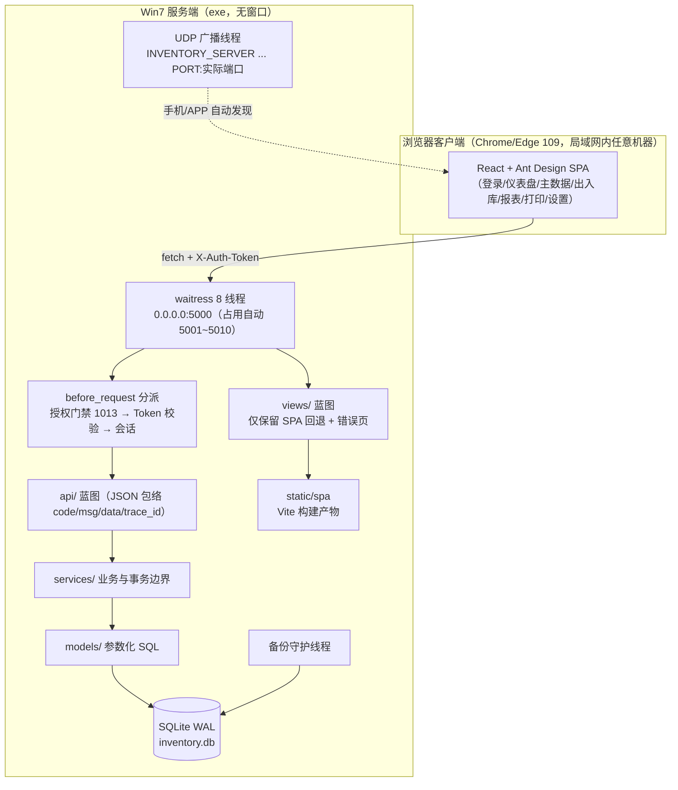
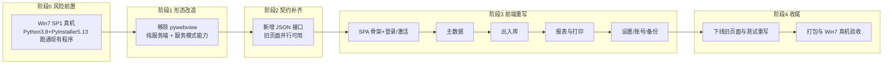

## 产品概述

把现有的「单机桌面程序」改造为「Windows 7 上可长期运行的局域网服务端 + 浏览器客户端」形态：服务器端开机即服务、无弹窗界面，局域网内任意机器用浏览器访问；同时把现有 28 个服务端渲染页面全量改版为企业级控制台风格的组件化界面（按你指定的 Ant Design 视觉规范），业务能力一项不减。

## 核心功能

- **服务端形态**：双击即启动 HTTP 服务与手机发现广播，不弹任何窗口；启动即展示/记录局域网访问地址与访问二维码；支持开机自启；对并发数与防火墙给出提示与引导。
- **浏览器访问**：同一局域网内的机器用 Chrome/Edge 109 打开即用；按角色（管理员/操作员）登录，登录后自动进入对应功能；未激活时进入激活页。
- **界面全量改版**：统一的企业级控制台界面——左侧导航 + 顶栏 + 内容区卡片 + 状态栏；表格（排序/分页 20/50/100/空状态/加载态/失败重试）、表单（即时校验/错误文案）、弹窗确认、全局提示、抽屉与侧栏在窄屏折叠。
- **业务功能全保留**：商品与条码、仓库、往来单位、入库/出库/盘点/冲销、流水查询与导出、库存现状与低库存预警、汇总报表、标签打印、设置、账号与设备管理、备份与恢复、离线激活。
- **扫码录入体验保留**：扫码框自动聚焦、回车即提交、成功后提示当前库存并保留仓库选择；连续扫描不打断。
- **打印**：标签打印页打印时只输出标签网格，报表可打印。
- **兼容性**：服务端可运行在 Windows 7 SP1；客户端基线为 Chrome/Edge 109（Win7 可安装的最高版本），不要求安装任何客户端软件。
- **多用户并发**：多台电脑同时访问同一服务端，数据实时一致；写入冲突有明确提示而非静默失败。

## 视觉与交互效果

打开浏览器即见登录页（居中卡片、品牌标识、错误即时提示）；登录后进入左侧导航的控制台布局，顶栏显示系统名与当前用户、主题切换；表格类页面首屏即为可用的数据列表（悬浮高亮、右侧固定操作列）；录入类页面左侧扫码/表单、右侧结果反馈；整体遵循同一套主色、圆角、阴影与间距规范，深浅色主题可切换。

## 技术栈选型

### 服务端（运行时，需在 Win7 SP1 上运行）

| 组件 | 版本 | 说明 |
| --- | --- | --- |
| Python | **3.8.10** | Win7 SP1 上可用的最后一个官方版本（3.9+ 安装器会因缺 KB2533623 等补丁拒绝运行）。**必须真机验证** |
| PyInstaller | **5.13.2** | 最后支持 Win7 的版本（6.x 已放弃 Win7）。onedir 模式 |
| Flask | 3.0.3 | 保持（requires-python >=3.8） |
| waitress | **2.1.2** | 由 3.0.0 降级：3.0.0 要求 Python >=3.9 |
| Flask-Login | 0.6.3 | 保持 |
| Pillow | **9.5.0** | 由 10.4.0 降级：10.x 在 Win7 上的 wheel 依赖需真机复核 |
| cryptography | **41.0.7** | 由 43.0.1 降级：43.x 的 Rust wheel 对 Win7 支持需真机复核 |
| qrcode[pil] / python-barcode / python-dotenv | 7.4.2 / 0.15.1 / 1.0.1 | 保持（纯 Python，无 Win7 风险） |
| pytest | 8.3.2 | 保持（dev） |
| **移除** | — | `pywebview 6.2.1`、`pythonnet 3.2.1`：Win7 无 WebView2，且新形态是纯服务端 |


### 前端（仅构建机需要）

Node 18.20 LTS（Vite 5 要求 Node >=18；Win7 只跑 exe，**不需要 Node 运行时**）· Vite 5 · React 18.3.1 · Ant Design 5 · @ant-design/icons 5 · react-router-dom 6 · TypeScript 5 · dayjs（antd 依赖）。全部用 `package-lock.json` 精确锁定 + `npm ci`。

## 实施方案

### 总体策略：风险前置 + 双轨过渡 + 分层交付

1. **风险前置**：Win7 兼容是整个改造里唯一「无法在本机验证」的部分，必须第一步在真机 Win7 SP1 上把**现有程序**（当前 Jinja 版）跑通，锁定 Python 3.8 依赖线；若这一步失败，后面的前端重写毫无意义。
2. **双轨过渡**：新增 JSON 接口时保持旧 Jinja 页面同时可用，SPA 逐页替换（主数据 → 出入库 → 报表 → 设置/账号/备份），任一时刻仓库都处于「可运行、测试全绿」状态；最后一阶段才删旧页面。
3. **前端构建产物入库**：构建产物提交到 `desktop/static/spa/`，这样 `pytest -q` 与 PyInstaller 打包**不依赖 Node**，Win7 服务器更不需要 Node。约定「改前端必须 `npm run build` 后一起提交」。

### 关键决策与取舍

- **认证模型统一到 Token**：SPA 复用现成的 `X-Auth-Token` 体系（`POST /api/login` 返回明文 token 一次，库内存哈希），token 存内存 + `sessionStorage`；好处是 CSRF 天然规避（不依赖 Cookie 自动携带）、无需 `form_token`，且与手机端同一套契约。代价：刷新页面需重新校验（用 `/api/me` 恢复会话），以及必须把授权拦截扩展到**全部** `/api/*`（`must_change_password=1` 时除改密外一律 403），这是 docs/03 的契约变更。
- **授权门禁语义改造**：`core/license_gate.py` 现在未激活时对页面返回 302、对 `/api/*` 返回 `403 {code:1013}`。SPA 化后前端本来就只走 `/api/*`，因此**保留 1013 语义**，把 SPA 的入口路径（`/`、`/assets/*`、`/activate`、`/login`）加进免拦截路径，由前端路由到激活页；不改动「每请求不重新验签」的性能约束。
- **SPA 回退路由必须排除 API**：任何 `/api/*`、`/healthz`、`/static/*` 之外的未匹配路径才回落到 `static/spa/index.html`。若写成通配，`/api/xxx` 的 JSON 404 会变成 HTML，手机端会解析失败。
- **CSP 只需维持 `style-src 'unsafe-inline'`**：antd v5 是 CSS-in-JS，运行期注入 `<style>`，现有 CSP 已允许；用 Vite 构建（不经 Babel standalone）因此**不需要也不允许** `unsafe-eval`，`script-src` 维持 `'self'`。
- **浏览器基线从 Chrome/Edge 120+ 下调到 88+（实测 109）**：antd v5 的样式依赖 `:where()`（Chrome 88+），Vite 的 `build.target` 设 `chrome88` 保证产物不用更新的语法。若客户实为 360/QQ 极速模式（内核常为 63~87），需按官方 `StyleProvider` 降级方案处理并**先实测内核版本**。
- **不引入 axios**：用原生 `fetch` + 一个统一封装（注入 `X-Auth-Token`、解包 `{code,msg,data,trace_id}`、统一 1013/1003 跳转、Toast 报错），与后端包络一一对应，少一个依赖。
- **打印页保留为 SPA 路由**：`@media print` 只留标签网格，不保留旧 Jinja 打印页，避免两套模板并存。

### 性能与可靠性

- SQLite 单写者：WAL 下读写不互斥，`synchronous=FULL` 保留不变；浏览器多客户端并发建议同时写入者不超过 3~5，写入冲突由 `busy_timeout=5000` 排队，超时才报 `database is locked`（文档里写明并在状态栏/设置页给出并发提示）。
- SPA 首屏：构建产物单一入口 + 路由级懒加载，静态资源带内容哈希 + 长缓存；`index.html` 不缓存。目标首屏（内网千兆）<2s。
- 不新增任何后台任务与轮询：保留现有守护线程备份，前端按需拉取。

### 实施注意（防回归）

- **绝对不动**：库存扣减的「条件更新 + `rowcount`」写法、`client_msg_id` 幂等、账本触发器、时间统一走 `timeutil.now_iso()`、`utf-8-sig` 的 CSV 导出、每请求一连接与 PRAGMA 组合。SPA 化只改「谁在调接口」，不改这些语义。
- **PyInstaller 5.13.2 与 6.x 的差异**：5.x 的 onedir 产物**没有 `_internal` 子目录**（DLL 与资源直接落在 `dist/<名>/` 下），`docs/04` T-32 里基于 `_internal` 的路径示例与排查手法全部失效，必须重写该条目。
- **构建产物未随包 = 白屏**：`datas` 必须包含 `static/spa`（以及仍保留的模板与 `db/migrations`、`license/resources/keys/public.pem`），这条要写成新的陷阱条目。
- **移除 pywebview 要清干净**：`core/gui.py`、`app.py:main()` 的 GUI 分支与 `_block_forever()`、`shell.js:initWindowButtons()` 的 `window.pywebview.api` 分流、`base.html` 的 `.sd-winbtns`、spec 里的 `collect_all("webview"/"pythonnet")`、`requirements.txt` 两行、PRD 20 章的 `SCANABLE_GUI`，以及 `docs/04` 的 T-33/T-34，否则会留下「看起来还有窗口能力」的死代码。
- **开发机限制**：本机 Python 3.12 与 Win10 环境**不能验证 Win7 结论**；Win7 相关条目一律标注为「真机验收项」，不得凭推测写成已完成。
- 日志与异常不得出现 `password`/`token`/`SECRET_KEY`；生产不暴露堆栈，500 只给 trace_id。

## 架构设计





## 目录结构

```
scanable-wms/
├── desktop/
│   ├── app.py                          # [MODIFY] 删 GUI 分支与 _block_forever；加 SPA 回退路由与静态目录挂载；
│   │                                   #   启动即记录/打印局域网访问地址与二维码；保留启动顺序（配置→建目录→迁移→绑定→HTTP→广播）
│   ├── core/
│   │   ├── gui.py                      # [DELETE] pywebview 封装整体移除
│   │   ├── service_mode.py             # [NEW] 服务模式支撑：对外地址+端口汇总、访问二维码生成到日志/启动信息、
│   │   │                               #   自启注册（评估 schtasks 与启动文件夹快捷方式，不新增 Python 依赖）、
│   │   │                               #   防火墙放行引导文案（TCP 5000~5010 + UDP 55555）、并发建议值
│   │   ├── license_gate.py             # [MODIFY] 免拦截路径扩到 SPA 入口（/、/assets/*、/login、/activate）；
│   │   │                               #   /api/* 保持 1013；不改「不在请求里重新验签」
│   │   ├── paths.py                    # [MODIFY] 增加 SPA 构建产物与静态目录解析（兼容冻结态 _MEIPASS）
│   │   ├── server.py                   # [MODIFY] 绑定信息与对外地址汇总（供启动信息与状态接口复用）
│   │   ├── migrator.py / logging_setup.py / response.py / errors.py / config_runtime.py / form_token.py
│   │   │                               # [KEEP] 不动（form_token 随旧页面下线后再评估删除）
│   ├── api/
│   │   ├── __init__.py                 # [MODIFY] 注册新蓝图
│   │   ├── users.py                    # [NEW] 账号与设备：GET/POST /api/users、改密、启停、GET /api/devices、
│   │   │                               #   POST /api/devices/<id>/revoke（全部 require_admin；复用 user_service/auth_service）
│   │   ├── activation.py               # [NEW] GET /api/activation/state（机器码+状态，免登录且免门禁）、
│   │   │                               #   POST /api/activation（提交注册码，成功后刷新 LICENSE_STATE）
│   │   ├── labels.py                   # [NEW] GET /api/labels（按关键字取待打印商品+条码 SVG/PNG+标签尺寸）、
│   │   │                               #   GET /api/products/<id>/barcode.svg|.png（复用 net/barcode_gen.py）
│   │   ├── reports.py                  # [MODIFY] 补 GET /api/stock/logs/<id>（冲销详情用）；导出保持流式 CSV
│   │   ├── system.py                   # [MODIFY] 补 GET /api/system/info（局域网地址候选、绑定端口、并发建议、
│   │   │                               #   磁盘与备份状态）、POST /api/backup/recalc；设置项按分组返回
│   │   ├── products.py / stock.py / sync.py / auth.py / ping.py
│   │   │                               # [MODIFY] 仅做 SPA 需要的字段补齐与分页/筛选参数对齐，业务语义不动
│   ├── views/
│   │   ├── __init__.py                 # [MODIFY] 只注册 SPA 回退与错误处理；旧页面蓝图注册移除
│   │   ├── spa.py                      # [NEW] GET / 与任意前端路由 → 返回 static/spa/index.html（排除 /api、/healthz、/static）
│   │   ├── auth.py / master.py / inventory.py / report.py / settings.py / dashboard.py / connect.py / activation.py
│   │   │                               # [DELETE] 服务端渲染页面下线（其能力全部由对应 /api/* + SPA 承担）
│   │   └── _helpers.py                 # [MODIFY] 保留会话辅助（打印/回退期仍需），逐步瘦身
│   ├── templates/
│   │   ├── base.html / partials/* / master/* / inventory/* / report/* / auth/* / activation/*
│   │   │                               # [DELETE] 28 个页面模板全部下线
│   │   └── errors/{403,404,500}.html   # [KEEP] 保留极简错误页（非 /api 路径兜底）
│   ├── static/
│   │   ├── js/*.js  css/{app,shell}.css# [DELETE] 自研 Fluent 皮肤与旧脚本下线（theme.js/common.js/shell.js/scan.js/...）
│   │   └── spa/                        # [NEW] Vite 构建产物（入库提交；不依赖 Node 即可运行与打包）
│   ├── web/                            # [NEW] 前端工程（仅构建机需要 Node）
│   │   ├── package.json / package-lock.json / tsconfig.json / vite.config.ts / index.html
│   │   ├── src/main.tsx / App.tsx / router.tsx
│   │   ├── src/api/client.ts           # fetch 封装：注入 X-Auth-Token、解包 {code,msg,data,trace_id}、
│   │   │                               #   401/1003 跳登录、403/1013 跳激活、Toast 化错误、trace_id 透传
│   │   ├── src/api/{auth,products,warehouses,partners,stock,reports,system,users,labels}.ts
│   │   ├── src/store/session.ts        # token 内存 + sessionStorage、当前用户与权限、must_change_password 状态
│   │   ├── src/layout/{AppShell,SideNav,TopBar,StatusBar,RequireAuth,RequireAdmin}.tsx
│   │   ├── src/pages/login / change-password / activate / dashboard / products / warehouses / partners
│   │   │   / stock-io(入出库扫码) / adjust / reverse / logs / current / summary / labels(打印) / settings / users / backup
│   │   └── src/styles/{global.css,print.css}
│   ├── requirements.txt                # [MODIFY] 按 Win7 线锁定：删 pywebview/pythonnet；waitress 2.1.2、Pillow 9.5.0、
│   │                                   #   cryptography 41.0.7；其余保持
│   ├── requirements-dev.txt            # [MODIFY] pyinstaller==5.13.2；pytest 保持
│   ├── ScanableSelf.spec               # [REWRITE] PyInstaller 5.13.2 写法：datas 含 templates(错误页)/static/spa/
│   │                                   #   db/schema.sql/db/migrations/license 公钥/barcode 字体；删 webview 收集；
│   │                                   #   hiddenimports 保留 waitress 子模块 + 动态蓝图 collect_submodules；
│   │                                   #   excludes 保留 pkg_resources/setuptools
│   ├── manage.py                       # [MODIFY] 增加 serve（服务模式启动）与 show-address 等运维命令；保持既有命令
│   └── tests/
│       ├── test_web_admin_pages.py     # [REWRITE] 32 例：由断言 HTML 改为断言对应 /api/* 契约
│       ├── test_web_auth_and_products.py # [REWRITE] 22 例：同上，登录/权限/商品写接口
│       ├── test_spa_serving.py         # [NEW] SPA 回退路由、静态资源、API 404 不被回退吃掉、未激活 1013
│       ├── test_api_users_devices.py   # [NEW] 账号与设备接口（含 require_admin 与 must_change_password）
│       ├── test_api_activation.py      # [NEW] 激活状态与提交注册码
│       └── (其余 9 个测试文件保持，仅做必要的接口字段对齐)
└── docs/
    ├── 01-产品需求文档.md              # [MODIFY] §0 规模声明（前端框架与构建链由禁止改为受控引入）、
    │                                   #   §2.1 版本表（Python 3.8/PyInstaller 5.13.2/依赖降级/前端构建链）、
    │                                   #   §2.2 选型理由改写、§11 浏览器基线改 Chrome/Edge 88+（实测 109）、
    │                                   #   §12 框架陷阱、§14.2 交付与启动形态（纯服务端）、§20 删 SCANABLE_GUI 增服务模式项、
    │                                   #   §28 UI 规范整体替换为 antd 主题规范、G6 指标重新定义并重测
    ├── 02-数据模型.md                   # [KEEP] 预计无表结构变更（接口补齐用既有表；若最终需要再加迁移）
    ├── 03-API接口规范.md                # [MODIFY] 新增接口清单（users/devices/activation/labels/system info/logs/<id>）、
    │                                   #   `/api/*` 全量授权与 must_change_password 语义、1013 在 SPA 下的流程、Token 存储建议
    ├── 04-开发规约与陷阱.md             # [MODIFY] 作废 T-31/T-33/T-34；重写 T-32（PyInstaller 5.x 无 _internal）；
    │                                   #   新增 T-35 SPA 回退吃掉 API 404、T-36 构建产物未随包导致白屏、
    │                                   #   T-37 antd v5 在旧内核/360 极速模式样式失效、T-38 Win7 上 Python/依赖版本线
    ├── 06-项目目录结构.md               # [MODIFY] 加入 web/ 与 static/spa/ 的说明与构建产物约定
    ├── 07-运维手册.md                   # [MODIFY] 服务端形态下的排障：白屏（构建产物/缓存）、端口、防火墙、自启、
    │                                   #   并发与 database is locked、Win7 特定问题
    ├── 08-上线检查清单.md               # [MODIFY] 验收项改为「Win7 真机服务端 + 浏览器访问」；体积/启动耗时重测
    ├── 09-扫雷审查与决策记录.md         # [MODIFY] 登记本次决策（服务端形态、antd 全量重写、认证改 Token、放弃 Fluent 皮肤）
    ├── 11-第三方软件接入指南.md         # [MODIFY] 打包与激活在 Win7 下的差异（cryptography 降级、公钥路径不变）
    ├── README.md                        # [MODIFY] 运行前提、浏览器基线、构建前端与打包步骤
    └── CODEBUDDY.md                     # [MODIFY] 技术栈清单、关键命令（含 npm ci / npm run build）、红线中「无前端框架」改写
```

## 关键代码结构

```python
# desktop/core/service_mode.py —— 服务模式对外信息（启动信息、二维码、并发建议）
def announce(bound: Bound) -> dict:
    """返回 {"url": "http://<ip>:<port>/", "candidates": [...], "qr_png_base64": ...}。

    ip 必须用 bound.ip（实际对外宣告地址，见 core/server.py 注释），端口用实际绑定端口，
    否则手机扫到的地址连不上（T-13/T-14 的同类错误）。
    """
```

```typescript
// desktop/web/src/api/client.ts —— 与后端包络一一对应的唯一出口
export interface Envelope<T> { code: number; msg: string; data: T; trace_id: string; }
export async function call<T>(path: string, init?: RequestInit): Promise<T>;
// 约定：code!==0 一律抛 ApiError(code,msg,data,trace_id)；1003 → 清 token 跳 /login；
// 1013 → 跳 /activate；网络层错误 → Toast 带 trace_id 供运维回溯
```

```python
# desktop/views/spa.py —— SPA 静态回退（唯一入口，必须排除 API 与静态）
@bp.get("/")
@bp.get("/<path:frontend_path>")
def index(frontend_path: str = ""):
    """非 /api、/healthz、/static 的未匹配路径才回退到 index.html，否则 JSON 404 会变成 HTML。"""
```

## 设计定位

全量改版为企业级数据控制台：信息密度优先、层级克制、操作路径短。以 Ant Design 5 的设计语言为基线（8px 栅格、4/8/12/16/24 间距阶梯、2px/6px 圆角、四档阴影），放弃上一版自研的 Windows 11 拟物皮肤与亚克力材质。

## 设计架构与布局

- 桌面端外壳：左侧固定导航 208px（分组 + 图标 + 选中胶囊）＋ 顶部栏 56px（系统名、当前用户、主题切换）＋ 内容区（浅灰底 `#F5F5F5` 上的白色卡片）＋ 底部状态栏 32px（广播状态、服务器地址、连接状态、追踪码、时钟）。
- 响应式：≥1200px 三列，768~1199px 导航收起为图标条，<768px 导航变抽屉；表格窄屏横向滚动而不压缩列。
- 目标浏览器：Chrome/Edge 109 及同内核浏览器；不针对 IE。

## 页面规划（5 个核心屏幕，其余功能页复用同一外壳与区块）

1. **登录 / 激活**：居中单卡片（最大宽 420px），上方品牌标识，下方表单；登录错误就地红字提示；未激活时同一位置切换为「机器码 + 注册码」两行表单并展示当前授权状态。
2. **仪表盘**：顶部 4 个统计卡（商品数、库存总量、今日入库、今日出库）＋ 双列（左：低库存预警表格；右：最近流水时间线）＋ 服务器信息卡（地址、绑定端口、备份状态）。
3. **出入库扫码台**：左列扫码/表单（条码框自动聚焦、回车提交、仓库与数量、备注），右列「最近一笔结果」大字反馈卡（含当前库存）＋ 本会话流水小表；顶部 Segmented 切换 入库/出库/盘点。
4. **流水查询**：顶部筛选区（日期范围、类型、仓库、操作员、关键字）＋ 表格（时间/类型/商品/仓库/数量/结存/往来单位/操作员/来源/备注，数值列右对齐等宽数字）＋ 分页 20/50/100 ＋ 导出 CSV 按钮 ＋ 行内「冲销」动作。
5. **库存现状**：汇总条（种类数、总量、低库存数、负数异常数）＋ 表格（商品/条码/仓库/库存/单位/下限），低库存标橙、负数标红；提供「仅看预警/仅看异常」切换。

设置、账号与设备、备份恢复、标签打印四页沿用同一外壳：分组卡片 + 表单/表格，打印页使用独立的最简布局（打印时只输出标签网格）。

## 视觉与交互规范

- 组件：Table（悬浮高亮、斑马纹关闭、操作列右固定）、Form（label 左对齐、必填星号、失焦即校验）、Modal（危险操作二次确认）、message/notification（成功信息 3s 自动消失、错误常驻并带追踪码）、Segmented、DatePicker.RangePicker、Empty、Skeleton、Spin 包裹的失败重试。
- 动效：表格行 150ms 背景过渡、Modal 与 Drawer 使用 antd 默认缓动、加载用骨架屏而非整页遮罩；不使用大幅位移或视差。
- 深浅色：`ConfigProvider` + `theme.darkAlgorithm` 一键切换，默认浅色；导航与状态栏在深浅两态下均保持足够对比度。
- 可访问性：所有图标按钮带 `aria-label`、表格有表头语义、焦点态可见、错误文案与字段关联。

## Agent Extensions

### SubAgent

- **code-explorer**
- Purpose: 在阶段 2/3 逐模块盘点「页面 → 现有接口 → 缺失接口」与 `services`/`models` 可复用函数，避免遗漏只在视图里查库的能力
- Expected outcome: 一份按页面归属的接口缺口清单与复用函数清单，作为新增接口的施工单
- **contract-auditor**
- Purpose: 每次改完 `api/` 或涉及表结构后，核对「代码 / schema.sql / docs/01 / docs/03」四方一致性（本方案会大量新增接口与错误码语义）
- Expected outcome: 契约差异清单（接口、字段、错误码、HTTP 状态码），确保 SPA 与文档、手机端契约不漂移

### Skill

- **playwright-cli**
- Purpose: 对 Chrome 109 内核做端到端验证——逐页跑通登录、扫码入库、流水查询、标签打印、深浅色与窄屏折叠，并截图留档
- Expected outcome: 关键流程的可复现脚本与截图证据，覆盖 pytest 无法触达的真实浏览器行为